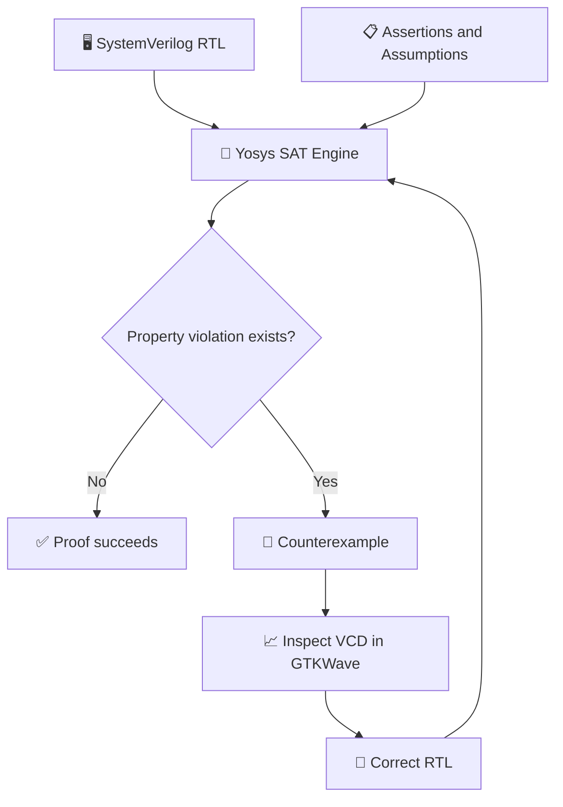
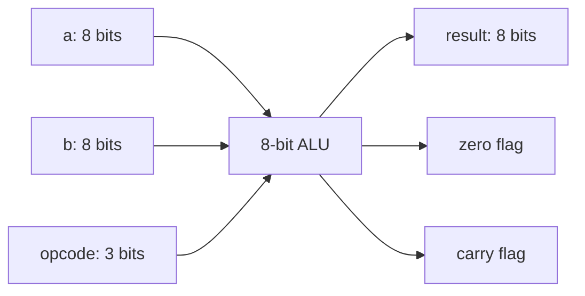
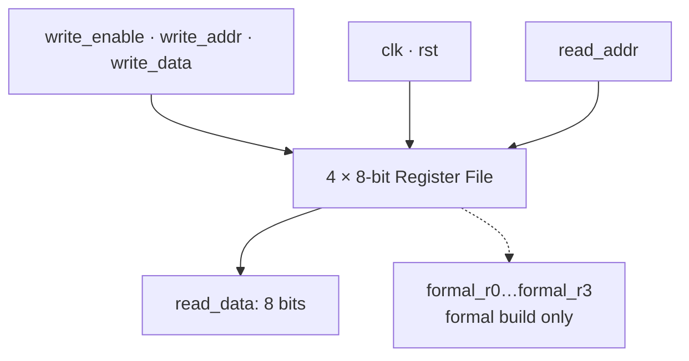

<div align="center">

# 🔬 Lab 05: Formal Verification of Digital Hardware

### SystemVerilog Assertions · SAT Solving · Temporal Induction · Fault Injection

[](https://en.wikipedia.org/wiki/SystemVerilog)
[](https://yosyshq.net/yosys/)
[](https://yosyshq.readthedocs.io/projects/yosys/en/latest/cmd/sat.html)
[](https://ubuntu.com/)
[](https://docs.github.com/en/actions)

[](https://github.com/zerokali20/AI-Hardware-Roadmap/actions/workflows/lab05-formal.yml)

**Verifying combinational and sequential hardware with mathematical proofs, intentional bugs, and reproducible automation.**

</div>

---

## 📑 Contents

- [🎯 Overview](#-overview)
- [🧰 Tools and setup](#-tools-and-setup)
- [📁 Repository structure](#-repository-structure)
- [🔄 Verification workflow](#-verification-workflow)
- [🧮 Part 1: Combinational ALU](#-part-1-combinational-alu)
- [💾 Part 2: Sequential register file](#-part-2-sequential-register-file)
- [🐛 Fault injection and counterexamples](#-fault-injection-and-counterexamples)
- [⚙️ Running verification](#️-running-verification)
- [🚀 Continuous integration](#-continuous-integration)
- [📊 Results](#-results)
- [🧠 Lessons and limitations](#-lessons-and-limitations)
- [📚 References](#-references)

## 🎯 Overview

This lab uses the **Yosys built-in SAT engine** to verify two SystemVerilog hardware designs:

1. An **8-bit combinational ALU** with eight operations, a zero flag, and a carry flag.
2. A **4 × 8-bit register file** with synchronous reset and writes, plus asynchronous reads.

The ALU is checked using symbolic inputs and combinational assertions. The register file is checked against a reference model using bounded verification and temporal induction. Intentional bugs demonstrate how a solver can find property violations and produce counterexample waveforms.

### Learning goals

- Express hardware requirements as SystemVerilog assertions.
- Understand symbolic inputs declared with `(* anyseq *)`.
- Distinguish combinational proofs from bounded sequential checks.
- Apply initialization assumptions and temporal induction.
- Detect deliberately injected RTL faults.
- Inspect VCD counterexamples in GTKWave.
- Automate proofs with Bash and GitHub Actions.

## 🧰 Tools and setup

| Tool | Role |
|---|---|
| **SystemVerilog** | Hardware RTL and formal properties |
| **Yosys 0.33** | RTL processing and built-in SAT solving used during development |
| **GTKWave** | Inspecting counterexample waveforms |
| **Bash** | Running repeatable verification commands |
| **Ubuntu on WSL** | Development environment |
| **GitHub Actions** | Automated verification on repository changes |

Install the essential tools on Ubuntu:

```bash
sudo apt-get update
sudo apt-get install -y yosys gtkwave
```

Check your Yosys version:

```bash
yosys -V
```

> **Note:** The scripts use the built-in Yosys SAT engine. Z3 and Boolector are not required to run these experiments.

## 📁 Repository structure

```text
AI-Hardware-Roadmap/
├── .github/
│   └── workflows/
│       └── lab05-formal.yml
└── labs/
    └── 05-formal-verification/
        ├── rtl/
        │   ├── alu.sv
        │   ├── register_file.sv
        │   ├── alu_correct.sv              # Optional backup
        │   └── register_file_correct.sv    # Optional backup
        ├── formal/
        │   ├── alu_properties.sv
        │   └── register_file_properties.sv
        ├── scripts/
        │   └── run_formal.sh
        ├── assets/                          # Add actual screenshots here
        │   ├── alu-counterexample.png
        │   └── register-file-counterexample.png
        ├── build/                           # Generated logs, ignored by Git
        ├── .gitignore
        └── README.md
```

Files marked *optional* or described as generated may not exist until created. The screenshots are not included in this README and should be added from your actual GTKWave experiments.

## 🔄 Verification workflow



The solver searches for a violation of the assertions. A successful proof means no violating assignment or execution exists **within the proof model and its assumptions**.

## 🧮 Part 1: Combinational ALU

### Architecture

The ALU has two 8-bit operands (`a`, `b`), a 3-bit `opcode`, and outputs including an 8-bit `result`, `zero`, and `carry`.



| Opcode | Operation |
|---|---|
| `000` | Addition |
| `001` | Subtraction |
| `010` | Bitwise AND |
| `011` | Bitwise OR |
| `100` | Bitwise XOR |
| `101` | Bitwise NOT |
| `110` | Logical left shift |
| `111` | Logical right shift |

### Symbolic inputs and assertions

The formal harness declares symbolic inputs:

```systemverilog
(* anyseq *) reg [7:0] a;
(* anyseq *) reg [7:0] b;
(* anyseq *) reg [2:0] opcode;
```

The input space contains:

\[
2^8 \times 2^8 \times 2^3 = 524,288
\]

possible operand and opcode combinations. SAT reasoning checks the specified combinational properties across this input space without enumerating a manually written test list.

Example properties include:

```systemverilog
if (opcode == 3'b000)
    assert(result == ((a + b) & 8'hFF));

assert(zero == (result == 8'h00));
```

The baseline formal harness contained **10 assertions**, covering the supported operations and status behavior.

### Run the ALU proof

```bash
yosys -Q -p "
read_verilog -formal -sv rtl/alu.sv formal/alu_properties.sv
prep -top alu_properties -flatten
sat -verify -prove-asserts -timeout 60
"
```

Recorded baseline result:

```text
Solving problem with 947 variables and 2673 clauses..
SAT proof finished - no model found: SUCCESS!
```

### ALU fault injection

Two deliberate faults were tested:

- **Subtraction bug:** replacing `result = a - b;` with `result = a + b;`.
- **Zero-flag bug:** changing the logic that reports whether `result` equals zero.

The formal checks detected the violations. After restoring the correct RTL, the proof passed again.

## 💾 Part 2: Sequential register file

### Architecture

The register file contains **four 8-bit registers**. It supports a synchronous reset, a synchronous write port, and an asynchronous read port.



| Signal | Width | Function |
|---|---:|---|
| `clk` | 1 | Rising-edge clock |
| `rst` | 1 | Synchronous reset |
| `write_enable` | 1 | Enables a write |
| `write_addr` | 2 | Selects write destination |
| `write_data` | 8 | Data to store |
| `read_addr` | 2 | Selects read source |
| `read_data` | 8 | Asynchronous read output |

On each rising edge, reset clears all registers. Otherwise, an enabled write updates the selected register. The read output continuously reflects the selected register.

### Reference model

The formal harness maintains an independent expected-state array:

```systemverilog
reg [7:0] expected [0:3];
```

After reset initialization, the harness checks the output against the expected selected register:

```systemverilog
assert(read_data == expected[read_addr]);
```

To strengthen the induction proof, the design also exposes each internal register in formal builds and compares **all four** register values with the reference model:

```systemverilog
assert(formal_r0 == expected[0]);
assert(formal_r1 == expected[1]);
assert(formal_r2 == expected[2]);
assert(formal_r3 == expected[3]);
assert(read_data == expected[read_addr]);
```

These extra ports are compiled only when `FORMAL` is defined by the formal frontend.

### Initial reset assumption

The harness models reset on the first clock cycle:

```systemverilog
reg first_cycle = 1'b1;

always @(posedge clk) begin
    if (first_cycle) begin
        assume(rst);
        first_cycle <= 1'b0;
    end
end
```

The reference-model assertions are enabled only after initialization. This assumption is part of the verification environment and must be considered when interpreting the proof.

### Bounded sequential check

```bash
yosys -Q -p "
read_verilog -formal -sv rtl/register_file.sv formal/register_file_properties.sv
prep -top register_file_properties -flatten
memory_map
opt_clean
sat -seq 10 -set-assumes -prove-asserts -verify -timeout 30
"
```

The bounded check tests for assertion violations over the modeled **10-step horizon**. It does not by itself prove correctness for arbitrarily long executions.

### Temporal induction

Induction strengthens the sequential verification by establishing a base case and an inductive step. A successful complete induction proof supports the assertions for all reachable cycles under the modeled assumptions.

```bash
yosys -Q -p "
read_verilog -formal -sv rtl/register_file.sv formal/register_file_properties.sv
prep -top register_file_properties -flatten
memory_map
opt_clean
sat -seq 3 -tempinduct -set-assumes -prove-asserts -verify -timeout 60
"
```

The original read-output-only induction was difficult for the solver to complete. Comparing all four register states gives the induction engine a stronger invariant. **Record a PASS for this strengthened proof only after its complete command finishes successfully.**

## 🐛 Fault injection and counterexamples

### Register address-decoding bug

Correct write:

```systemverilog
registers[write_addr] <= write_data;
```

Injected fault:

```systemverilog
registers[write_addr ^ 2'b01] <= write_data;
```

The injected fault changes the destination address, such as writing to `R1` instead of the requested `R0`. The sequential checker detected the mismatch. Restoring the original RTL returned the bounded check to PASS.

### Generate a counterexample waveform

For an intentionally faulty register-file build:

```bash
yosys -Q -p "
read_verilog -formal -sv rtl/register_file.sv formal/register_file_properties.sv
prep -top register_file_properties -flatten
memory_map
opt_clean
sat -seq 10 -set-assumes -prove-asserts \
-show-inputs -show-outputs \
-dump_vcd register_counterexample.vcd
"
```

Then inspect it:

```bash
gtkwave register_counterexample.vcd
```

**Suggested signals:** `rst`, `write_enable`, `write_addr`, `write_data`, `read_addr`, and `read_data`.

### 📸 Waveform screenshots

When you have captured your real GTKWave screenshots, place them in `assets/` and uncomment the image lines below:

<!--  -->
<!--  -->

| Experiment | What to capture |
|---|---|
| **ALU subtraction fault** | Operands, opcode, and incorrect result |
| **Register address fault** | Write address, write data, read address, and resulting mismatch |

## ⚙️ Running verification

From the lab directory:

```bash
cd /mnt/d/AI-Hardware-Roadmap/labs/05-formal-verification
bash scripts/run_formal.sh
```

The script runs the ALU proof and the register-file induction proof. It stores logs in `build/` and exits on a verification failure.

Expected summary after **both** checks complete successfully:

```text
[1/2] Verifying ALU...
[PASS] ALU formal verification
[2/2] Verifying register file...
[PASS] Register-file induction proof
All formal verification checks PASSED
```

If the register-file proof continues increasing its induction length, it has **not** finished successfully. Review the properties and assumptions instead of marking the run as PASS.

## 🚀 Continuous integration

The workflow at `.github/workflows/lab05-formal.yml` runs the lab's verification script on GitHub's Ubuntu runner. It installs Yosys and executes the same automated checks used locally.

The status badge at the top of this README reflects the GitHub Actions workflow once it is committed and has run.

A recommended `.gitignore` for the lab is:

```gitignore
build/
*.vcd
*.log
```

### Push your work

After the complete local script passes:

```bash
cd /mnt/d/AI-Hardware-Roadmap
git add labs/05-formal-verification/ .github/workflows/lab05-formal.yml
git status
git commit -m "Document Lab 05 formal verification and automation"
git push
```

Then check the [GitHub Actions page](https://github.com/zerokali20/AI-Hardware-Roadmap/actions) for the CI result.

## 📊 Results

| Experiment | Method | Observed outcome |
|---|---|---|
| 8-bit ALU baseline | Combinational SAT | ✅ PASS |
| ALU subtraction fault | Fault injection | 🐛 Violation detected |
| ALU zero-flag fault | Fault injection | 🐛 Violation detected |
| Register-file baseline | Bounded SAT | ✅ PASS |
| Register address-decoding fault | Fault injection | 🐛 Violation detected |
| Restored register file | Bounded SAT | ✅ PASS |
| Initial register-file induction | Temporal induction | ✅ Previously reported PASS |
| Strengthened all-register induction | Temporal induction | 🔍 Confirm complete local run |
| GitHub Actions | Automated CI | 🔍 Confirm workflow status |

**Interpretation:** The recorded results demonstrate that the assertions can detect several realistic RTL faults. They do not imply that every possible hardware requirement has been formally specified.

## 🧠 Lessons and limitations

1. **Assertions define the scope of a proof.** A solver can prove only the properties actually written in the formal harness.
2. **Symbolic inputs improve coverage.** The ALU proof reasons across the complete symbolic operand and opcode space.
3. **Sequential verification needs state reasoning.** Reset assumptions, reference models, and induction invariants matter.
4. **Bounded success differs from induction success.** A bounded check covers a finite horizon, while successful induction can establish an invariant for all reachable cycles.
5. **Fault injection tests the testbench.** Deliberately broken RTL should produce counterexamples. If it does not, the properties may be incomplete.
6. **Automation improves reproducibility.** The same proof commands can run locally and in CI.

## 🏁 Conclusion

Lab 05 demonstrates a practical formal verification workflow for small digital hardware blocks. It combines combinational SAT proofs, sequential reference-model checking, temporal induction, intentional fault injection, waveform inspection, and CI automation.

These techniques form a foundation for future work on processor datapaths, control logic, pipelines, memory interfaces, and hardware accelerators.

## 📚 References

- [Yosys Open Synthesis Suite](https://yosyshq.net/yosys/)
- [Yosys documentation](https://yosyshq.readthedocs.io/)
- [Yosys SAT command](https://yosyshq.readthedocs.io/projects/yosys/en/latest/cmd/sat.html)
- [GTKWave](https://gtkwave.sourceforge.net/)
- [GitHub Actions documentation](https://docs.github.com/en/actions)

---

<div align="center">

**AI Hardware Roadmap · Lab 05 · Formal Verification with Yosys SAT**

[⬆ Back to top](#-lab-05-formal-verification-of-digital-hardware)

</div>
