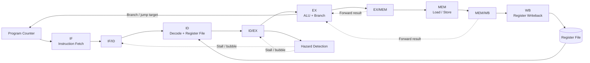

<div align="center">

# 🧠 Lab 06 · Five-Stage RISC-V Pipeline CPU

**A SystemVerilog RV32I-oriented processor, verified with cocotb and Icarus Verilog**

[](rtl/)
[](https://riscv.org/)
[](tb/)
[](scripts/run_regression.sh)
[](docs/verification.md)
[](https://github.com/zerokali20/AI-Hardware-Roadmap/actions/workflows/lab06-riscv-pipeline.yml)

**[Architecture](#-architecture) · [Features](#-implemented-functionality) · [Verification](#-verification) · [Performance](#-performance) · [Quick Start](#-quick-start) · [Documentation](#-documentation)**

</div>

---

## ✨ Overview

This lab builds and tests a **five-stage, in-order, 32-bit RISC-V pipeline CPU**. The project brings together instruction fetch and decoding, an ALU, register file, byte-addressed data memory, forwarding, pipeline interlocks, and branch/jump redirects. Its focus is on **observable, testable processor behavior**, from individual RTL blocks through full-CPU execution.

> **Scope:** This is an educational RV32I-oriented implementation with verified instruction categories and hazard behavior. It is **not claimed to be fully RV32I compliant**, exception-complete, or FPGA-validated.

### At a glance

| 🔧 Design | 🧪 Verification | 📊 Benchmarking | 🔍 Debugging |
|:---|:---|:---|:---|
| 5 pipeline stages | 30 passing suites | 6 workloads | GTKWave/VCD |
| Forwarding + interlocks | 329 passing tests | CPI 1.500–1.750 | Per-stage PCs |
| Branch redirects | cocotb + Icarus | Stall/redirect counts | Pipeline control signals |

## 🏗️ Architecture



| Stage | Main responsibility | Observable signal |
|---|---|---|
| **IF** | Select PC and fetch instruction | `fetch_pc` |
| **ID** | Decode instruction, read operands, generate immediate | `decode_pc` |
| **EX** | Execute ALU operation, resolve branches, select forwarded operands | `execute_pc` |
| **MEM** | Access byte-addressed data memory | `mem_pc` |
| **WB** | Select ALU/load/link result and write register | `wb_pc`, `wb_data`, `wb_rd` |

**Detailed explanation:** [Architecture and hazards](docs/architecture.md).

## ⚙️ Implemented functionality

| Area | Verified capabilities |
|---|---|
| **Integer datapath** | ADD, SUB, bitwise logic, shifts, signed/unsigned comparisons, immediate arithmetic |
| **Upper immediates** | LUI, AUIPC |
| **Memory** | LB, LBU, LH, LHU, LW, SB, SH, SW; little-endian byte storage |
| **Control flow** | BEQ, BNE, BLT, BGE, BLTU, BGEU, JAL, JALR |
| **Data hazards** | EX/MEM and MEM/WB forwarding; register writeback-to-decode bypass |
| **Load-use hazards** | Fetch/decode hold and ID/EX bubble insertion |
| **Control hazards** | EX-stage redirect and younger-instruction flushing |
| **Error indication** | Memory access/alignment reporting and unsupported-opcode indication, without a complete trap handler |
| **Observability** | VCD waveform generation and simulation-only performance counters |

### Hazard behavior

- **ALU dependencies:** Forwarding avoids extra stalls in the tested arithmetic chains.
- **Load-use dependency:** A dependent consumer incurs **one additional cycle** in the tested workload.
- **Taken branch / JAL:** Redirect and flush cost **two additional cycles** in the tested workloads.
- **Not-taken branch:** No redirect penalty in the tested workload.

## 🧪 Verification

The RTL is tested at unit, integration, and complete-CPU levels. The latest full regression reported:

| Measure | Result |
|---|---:|
| Test suites | **30 passed / 30 total** |
| Individual tests | **329 passed** |
| Failed suites | **0** |
| CPU performance tests | **6 passed** |

The regression performs a clean build before each suite because different tests use different simulation top-level modules.

```bash
./scripts/run_regression.sh
```

See [verification strategy and suite coverage](docs/verification.md).

## 📈 Performance

All benchmarks execute **eight architecturally intended instructions**. The performance monitor tracks pipeline-valid state for these controlled tests. Values include startup/drain overhead.

| Benchmark | Cycles | Retired | Stalls | Redirects | CPI |
|---|---:|---:|---:|---:|---:|
| Independent arithmetic | 12 | 8 | 0 | 0 | **1.500** |
| Arithmetic forwarding | 12 | 8 | 0 | 0 | **1.500** |
| Load-use dependency | 13 | 8 | 1 | 0 | **1.625** |
| Branch not taken | 12 | 8 | 0 | 0 | **1.500** |
| Branch taken | 14 | 8 | 0 | 1 | **1.750** |
| JAL jump | 14 | 8 | 0 | 1 | **1.750** |

```text
Independent    ███████████████       1.500
Forwarding     ███████████████       1.500
Load-use       ████████████████▎     1.625
Not taken      ███████████████       1.500
Taken branch   █████████████████▌    1.750
JAL            █████████████████▌    1.750
```

**CPI = measured cycles / retired instructions.** These are small, synthetic simulation workloads, not an average across real applications or a measured clock-frequency result.

See [benchmark methodology and interpretation](docs/performance.md).

## 🚀 Quick start

### Prerequisites

- Ubuntu or WSL Ubuntu
- Icarus Verilog (`iverilog`, `vvp`)
- Python 3 with `venv`
- GNU Make
- GTKWave (optional for waveform inspection)

```bash
sudo apt update
sudo apt install -y iverilog gtkwave make python3 python3-venv
```

### Clone and install

```bash
git clone https://github.com/zerokali20/AI-Hardware-Roadmap.git
cd AI-Hardware-Roadmap/labs/06-riscv-pipeline
python3 -m venv .venv
source .venv/bin/activate
pip install -r requirements.txt
```

### Run tests

```bash
make clean && make TEST=cpu          # CPU integration
make clean && make TEST=cpuhaz       # Pipeline hazards
make clean && make TEST=cpuisa       # RV32I-oriented instruction tests
make clean && make TEST=cpumembranch # Memory and branches
make clean && make TEST=cpuperf      # Performance benchmarks
./scripts/run_regression.sh         # All 30 suites
```

> **Why `make clean`?** The same `sim_build` directory is reused across different simulation top-levels. Cleaning avoids stale top-level mismatches.

### Generate and inspect waveforms

```bash
make clean && make TEST=cpuwave
gtkwave pipeline_waveform.vcd
```

Recommended signals: `clk`, `rst`, `fetch_pc`, `decode_pc`, `execute_pc`, `mem_pc`, `wb_pc`, `load_use_stall`, `branch_redirect`, `forward_a`, `forward_b`, `wb_reg_write`, `wb_rd`, and `wb_data`.

## 🗂️ Project layout

```text
06-riscv-pipeline/
├── rtl/                     # CPU and pipeline SystemVerilog modules
├── tb/                      # cocotb unit, integration and CPU tests
├── programs/                # Instruction memory program(s)
├── scripts/
│   └── run_regression.sh    # Clean-build full regression
├── docs/
│   ├── architecture.md      # Datapath, control and hazards
│   ├── verification.md      # Test strategy and regression
│   └── performance.md       # Six benchmark measurements
├── Makefile                 # TEST=... simulation selection
├── requirements.txt         # Python dependencies
├── .gitignore
└── README.md
```

## 📚 Documentation

| Document | Contents |
|---|---|
| [Architecture & hazards](docs/architecture.md) | Pipeline stages, forwarding, stalls, redirects and limitations |
| [Verification guide](docs/verification.md) | Coverage layers, test commands, regression results and troubleshooting |
| [Performance report](docs/performance.md) | Benchmark methodology, measurements, CPI interpretation and caveats |

## 🚧 Current limitations and future work

- No complete trap/exception handling or privileged/CSR support.
- No formal ISA compliance certification or comprehensive illegal-instruction validation.
- No instruction/data caches, branch predictor, or operating-system support.
- No synthesis, static timing analysis, FPGA deployment, or measured operating frequency.
- The performance monitor is designed for controlled simulation workloads and should be extended and independently validated for longer, more complex programs.

**Possible next experiments:** randomized instruction streams, architectural reference-model comparison, longer benchmarks, exception/trap support, synthesis, and FPGA implementation.

---

<div align="center">

Built as part of **[AI-Hardware-Roadmap](https://github.com/zerokali20/AI-Hardware-Roadmap)** · RTL design · Verification · Computer architecture

</div>
