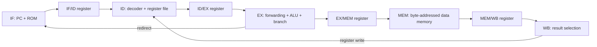

# 🏗️ Architecture and Hazard Handling

[← Project README](../README.md) · [Verification](verification.md) · [Performance](performance.md)

## 1. Design overview

The processor is an educational **five-stage, in-order, 32-bit RISC-V pipeline**. The datapath is partitioned into Instruction Fetch (IF), Instruction Decode (ID), Execute (EX), Memory (MEM), and Writeback (WB). Registers between stages hold the instruction context and control values as the pipeline advances.



## 2. Stage responsibilities

| Stage | Primary work | Selected signals |
|---|---|---|
| IF | Fetch instruction using PC; update sequential or redirected PC | `fetch_pc` |
| ID | Decode opcode, generate immediate, read register operands | `decode_pc` |
| EX | Compute ALU results, compare branches, calculate targets | `execute_pc`, `forward_a`, `forward_b` |
| MEM | Read/write byte-addressed little-endian memory | `mem_pc` |
| WB | Select ALU, load or jump-link value for register writeback | `wb_pc`, `wb_data`, `wb_rd`, `wb_reg_write` |

## 3. Data forwarding

When a consumer depends on a value still in the pipeline, the forwarding unit selects a newer value rather than waiting for it to reach the register file. Forwarding paths are available from EX/MEM and MEM/WB. Jump link values are forwarded appropriately, and the decode stage also has a writeback bypass.

```text
ADD x3, x1, x2
ADD x4, x3, x1    <- x3 can be forwarded
ADD x5, x4, x2    <- x4 can be forwarded
```

The tested dependent arithmetic chain completes in the same 12 cycles as eight independent instructions.

## 4. Load-use interlock

A load value is not available at the same point as an ordinary ALU result. When the immediately following instruction consumes the loaded destination register, hazard detection requests a stall. The control unit holds the fetch/decode progress and injects a bubble into ID/EX.

```text
LW   x2, 0(x0)
ADDI x3, x2, 5    <- dependent consumer: one stall in benchmark
```

The verified eight-instruction benchmark records **one stall**, **13 cycles**, and **CPI 1.625**.

## 5. Branch and jump redirects

The EX stage resolves supported conditional branches and jumps. A valid taken redirect overrides an ordinary load-use stall. The control unit flushes younger IF/ID and ID/EX instructions and directs the PC to the target.

| Event | PC action | Younger instructions | Measured penalty |
|---|---|---|---:|
| Branch not taken | Continue sequentially | Remain valid | 0 cycles |
| Branch taken | Redirect to target | Flush | 2 cycles |
| JAL | Redirect to target | Flush | 2 cycles |

The branch tests check that a wrong-path instruction does not write its intended destination register.

## 6. Memory model and diagnostics

The test memory is **byte-addressed and little-endian**. The verified operations include byte, halfword and word loads/stores, with sign extension for signed loads and zero extension for unsigned loads. Alignment and access errors are surfaced as status signals. They are **not** handled by a full architectural trap mechanism.

## 7. Performance-monitor scope

A simulation-only monitor tracks cycles, pipeline-valid propagation, retired instruction count, load-use stalls, and redirects. It is enabled for performance builds. The present benchmarks have been checked against expected pipeline timing, but the monitor is **not** a replacement for a complete architectural commit/retirement interface, particularly for exceptions, unusual stalls or arbitrary programs.

## 8. Boundaries

The current design should not be described as a fully compliant RV32I core, an FPGA-proven implementation, or a processor with complete exception handling. See the main README for remaining work.
